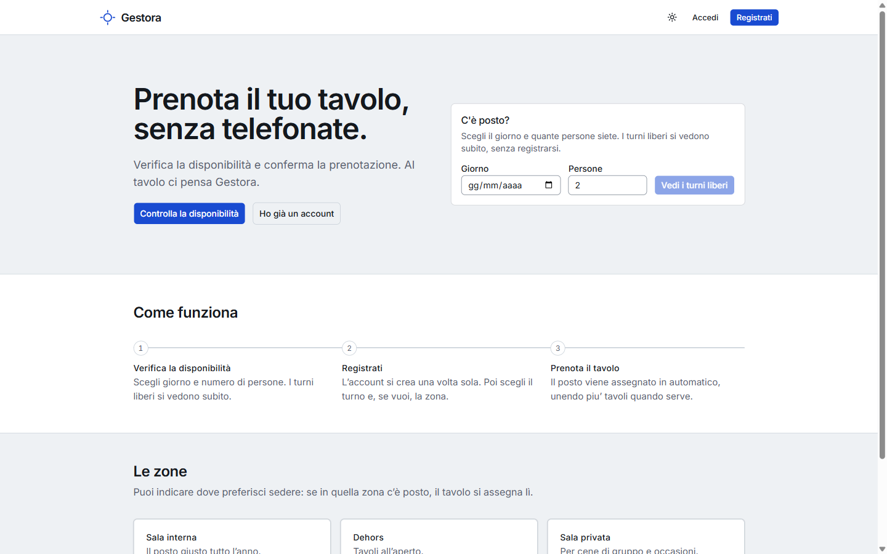
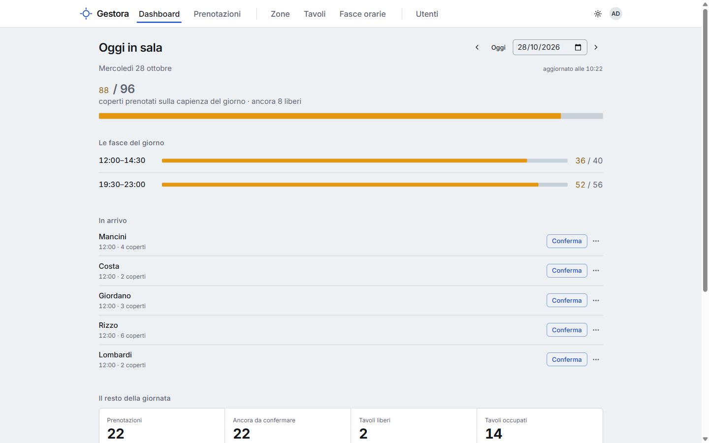
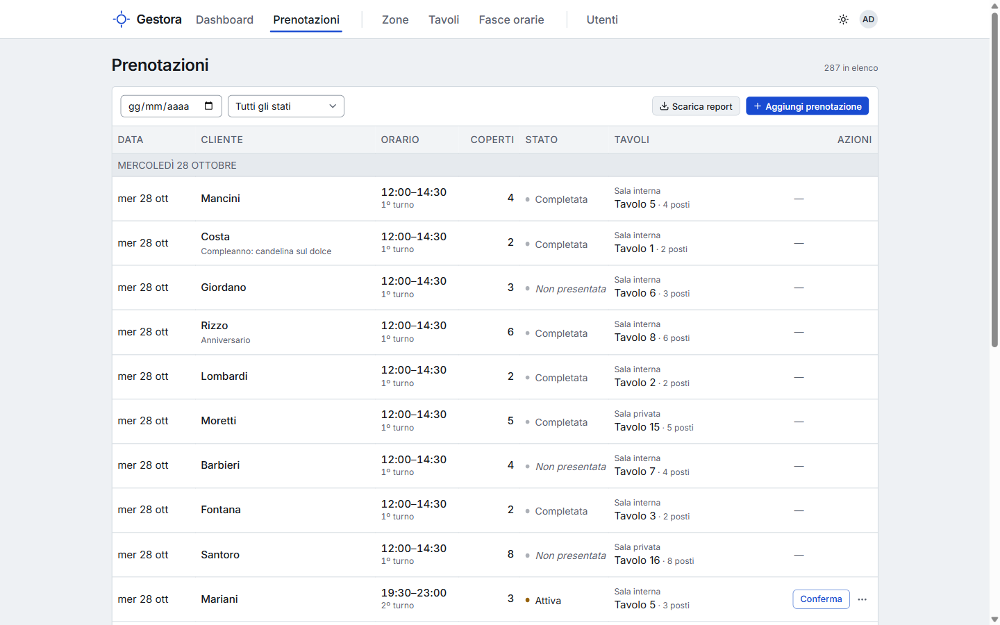
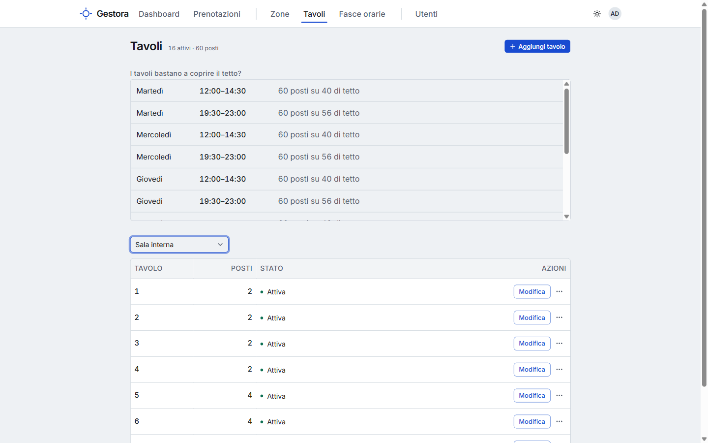

# Gestora

**Reservations and floor management for restaurants, pubs and pizzerias.**

Gestora lets a venue set up its dining room, take bookings from staff and customers, and assign
tables automatically — joining tables when a party is too big for one, always picking the
combination that wastes the fewest seats.

🌐 **Live:** [gestora-project-xi.vercel.app](https://gestora-project-xi.vercel.app)
&nbsp;·&nbsp; The interface is in Italian.



---

## Screenshots

| Today's service at a glance | Bookings, with the tables Gestora assigned |
|---|---|
|  |  |

| Floor setup: tables and room capacity | Availability check from a phone, no sign-up |
|---|---|
|  |  |

Sample data from a fictional pizzeria (`dotnet run -- --seed-vetrina`).

---

## What it does

- **Floor setup** — zones, tables with their capacity, and time slots with a cap on covers
  (guests), not on the number of bookings.
- **Bookings** — taken by staff (phone calls included, up to 50 guests) or made online by customers
  (up to 20). A public page lets anyone check availability without signing up.
- **Automatic table assignment** — see [below](#how-tables-are-assigned).
- **Dashboard** for the service: today's bookings slot by slot with their tables, how full each
  slot is, and the week ahead.
- **Reports** — bookings exported to CSV for any date range, ready for Excel.
- **Accounts and privacy** — email confirmation on sign-up, password reset, a "My account" page
  to change password or delete the account, privacy notice acceptance, activity log kept 24
  months, inactive accounts removed after a warning email.
- **Public feedback form** — sent by email, never stored, with spam protection.

### Roles

| Role | Can do |
|---|---|
| **Admin** | Configure zones, tables and slots; manage users; export reports |
| **Staff** | Take and manage all bookings; use the dashboard |
| **Customer** | Book online and manage their own bookings |

A user can hold more than one role. The first Admin is created from a one-time setup screen.

### How tables are assigned

For each booking Gestora looks at the free tables of the chosen zone and tries every single
table and every combination of tables, then keeps the one with the **fewest empty seats**; on a
tie, the one with fewer tables. Joining only 2-seat tables gains the head seats (two tables seat
6, three seat 8); any other mix seats the plain sum.

The slot is full when its cover cap is reached, and the cap can never exceed the seats actually
in the room. The "seats left" shown to guests is the smaller of the remaining cap and the largest
party the free tables can still host — so the app never promises a seat it cannot give.

---

## Tech stack

| | |
|---|---|
| **Backend** | ASP.NET Core 10 (LTS) · Entity Framework Core 10 · PostgreSQL · ASP.NET Identity + JWT · Quartz.NET (scheduled jobs) · FluentValidation · AutoMapper · Serilog |
| **Frontend** | React 19 · TypeScript · Vite · React Router v7 · TanStack Query v5 · React Hook Form + Zod · shadcn/ui · Tailwind CSS v4 |
| **Tests** | xUnit + Moq (backend) · Vitest + Testing Library (frontend) |
| **Hosting** | Azure App Service (API, Docker image from Docker Hub) · Vercel (frontend) · Neon (PostgreSQL) |
| **CI** | GitHub Actions: build and tests for both sides; when the backend changes on `main`, the Docker image is published only after the tests pass |

### Architecture

A **layered** design inside a single API project — `Controller → Service → Repository →
database` — chosen on purpose: for an application of this size it keeps the code easy to follow
without the ceremony of Clean Architecture or DDD.

```
Gestora/
├── GestoraWebApi/         ASP.NET Core API
├── GestoraWebApi.Tests/   backend tests (xUnit)
├── gestora-frontend/      React app
└── Gestora.sln            solution: API + tests
```

Security in short: JWT authentication with role-based authorization, the token kept in an
`HttpOnly` cookie (never readable by JavaScript) with double-submit CSRF protection, API calls
proxied through the frontend's own domain by a Vercel middleware, rate limits on login,
sign-up, email confirmation, password reset, availability checks and feedback, a 15-minute block after 5 wrong passwords, applied to the address that failed rather than to the account (so nobody can lock the Admin out), security
headers on both API and frontend (CSP, HSTS), Data Protection keys persisted in the database.

---

## Running locally

**Prerequisites:** .NET SDK 10, Node.js 24, PostgreSQL.

**1. Backend** — from `GestoraWebApi/`, set the two secrets, create the database, start the API:

```bash
dotnet user-secrets set "ConnectionStrings:DefaultConnection" "Host=localhost;Database=gestora_db;Username=postgres;Password=<your-password>"
```

```bash
dotnet user-secrets set "JwtSettings:Secret" "<a random string of at least 32 characters>"
```

```bash
dotnet ef database update
```

```bash
psql -U postgres -d gestora_db -f Scripts/quartz_postgres.sql
```

```bash
dotnet run
```

The API listens on `http://localhost:5099`. In development, emails are written to the log
instead of being sent. To fill the database with sample data, start it once with
`dotnet run -- --seed-vetrina` (a realistic pizzeria) or `dotnet run -- --seed-sviluppo` (edge
cases for testing the interface). Both **wipe** the local bookings, tables and slots, and refuse to
run against a database that is not on `localhost`. Sign in as `admin@gestora.local` /
`Sviluppo1!`.

**2. Frontend** — from `gestora-frontend/` (the Vite dev server forwards `/api` to the backend on
`localhost:5099`; sign in with Chrome, Edge or Firefox, since Safari refuses `Secure` cookies on
`http://localhost`):

```bash
npm install
```

```bash
npm run dev
```

Open `http://localhost:5173`. On an empty database you land on the setup screen that creates the
first Admin.

### Tests

```bash
dotnet test Gestora.sln
```

```bash
cd gestora-frontend && npm test && npm run lint && npm run build
```

Release history: [CHANGELOG.md](CHANGELOG.md).

---

## License

© 2026 Fabio Iacurto. **All rights reserved.** The source code is published for viewing only:
it may not be copied, modified or redistributed without written permission. See
[LICENSE](LICENSE).
